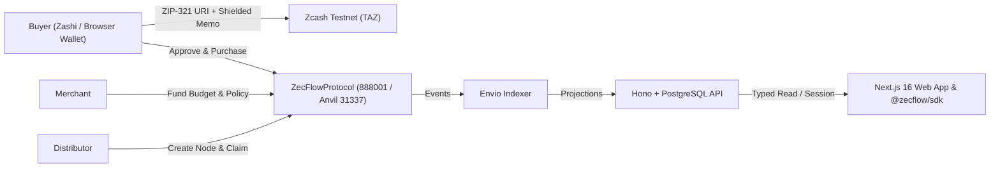

<div align="center">
  
  <h1>ZecFlow</h1>
  <p><strong>Privacy-Preserving Open Distribution Protocol for Zcash</strong></p>
  <p><em>Pay for revenue, not reach. Deterministic on-chain referral splits with Zcash shielded settlement.</em></p>

  <p>
    <a href="https://zecflowlive.vercel.app"><strong>Live App</strong></a> ·
    <a href="https://zecflowlive.vercel.app/demo"><strong>Interactive Demo</strong></a> ·
    <a href="https://docs.usezecflow.xyz"><strong>Documentation</strong></a> ·
    <a href="docs/ZCASH_GRANT_PROPOSAL.md"><strong>Zcash Grant Proposal</strong></a> ·
    <a href="https://www.npmjs.com/package/@zecflow/sdk"><strong>npm SDK</strong></a>
  </p>

  <p>
    <a href="LICENSE"></a>
    
    
    =24" />
    
  </p>
</div>

---

## Overview

Traditional affiliate and referral networks force merchants and creators to hand over buyer identities, purchase histories, and social graphs to centralized trackers—while still paying for clicks or unverified impressions.

**ZecFlow** flips this model into an open, verifiable, and privacy-preserving protocol built for the Zcash ecosystem:

- **Merchants** publish products, fund a dedicated reward budget up front, and define transparent commission rules.
- **Distributors** generate referral links that can branch organically through trusted communities (up to 5 levels deep).
- **Buyers** purchase with **Zcash Unified Addresses (`u1` / `utest1`)**, **ZIP-321 shielded payment URIs**, or connected wallets—without exposing their social graph to centralized ad trackers.
- **Settlement** happens deterministically: rewards come strictly from the merchant's pre-funded budget and are only released after the hold/refund window closes.

> **Current Deployment:** Programmable escrow & attribution run on **Zcash Testnet (TAZ, Chain ID `888001`)** using non-redeemable **ZecFlowToken (`ZFT`)** alongside native **ZIP-321 Zcash Testnet (`TAZ`)** payment URI & QR generation. **Demo mode** at [`zecflowlive.vercel.app/demo`](https://zecflowlive.vercel.app/demo) provides an instant local walkthrough with sample data.

---

## How ZecFlow Works (Dynamic Lifecycle)

Every sale in ZecFlow follows a deterministic, auditable lifecycle where **buyer payments** and **merchant-funded rewards** are strictly isolated in separate on-chain ledgers:

```mermaid
sequenceDiagram
  autonumber
  actor Merchant
  actor Distributor as Distributor(s)
  actor Buyer
  participant Protocol as ZecFlowProtocol (888001)
  participant Zcash as Zcash Shielded (ZIP-321)

  Merchant->>Protocol: 1. Create campaign, set policy (1–5 levels) & fund reward budget
  Distributor->>Protocol: 2. Create referral node (root or branched from parent node)
  Buyer->>Zcash: 3. Scan ZIP-321 QR / pay with encrypted Orchard attribution memo
  Buyer->>Protocol: 4. Purchase via referral node (snapshots policy & path)
  Note over Protocol: Buyer payment enters Proceeds Ledger.<br/>Max reward reserved in Reward Ledger.
  alt Refunded before hold window ends
    Merchant->>Protocol: 5a. Refund sale
    Protocol-->>Buyer: Full payment returned; reserved reward released to budget
  else Hold window elapses
    Protocol->>Protocol: 5b. Finalize sale (vests rewards & unlocks proceeds)
    Distributor->>Protocol: 6a. Pull-claim deterministic share
    Merchant->>Protocol: 6b. Pull-claim net sale proceeds
  end
```

### Example: Nearest-First Multi-Level Splits

Suppose a merchant configures a **10% total reward** across **3 levels** with weights **`70% / 20% / 10%`** (7000 / 2000 / 1000 bps) on a **100 ZFT** product:

| Referral Depth | Eligible Path            | Reward Pool (`10 ZFT`) | Split Calculation                       |
| -------------- | ------------------------ | ---------------------- | --------------------------------------- |
| **Direct (1)** | `D1`                     | `10 ZFT`               | `D1` receives **10 ZFT**                |
| **2-Hop**      | `D2 → D1` (D2 is closer) | `10 ZFT`               | Renormalized: `D2` & `D1`               |
| **3-Hop**      | `D3 → D2 → D1`           | `10 ZFT`               | `D3`: 7 ZFT · `D2`: 2 ZFT · `D1`: 1 ZFT |

- **Snapshot at Purchase:** Policy terms and the active referral path are snapshotted at the exact block of purchase.
- **24-Hour Policy Timelock:** Merchants can register policy updates, which only take effect after a 24-hour public notice period—never retroactively affecting existing sales.
- **Remainder-Safe Rounding:** Integer division remainders are deterministically assigned so total payouts never exceed the reserved budget.

---

## Core Capabilities

1. **Zcash Shielded Settlement (ZIP-321 & Orchard Memos)**
   - Native validation for **Unified (`u1...` / `utest1...`)**, **Sapling (`zs1...`)**, and **Transparent (`t1...` / `tm...`)** addresses plus **Unified Viewing Keys (`uview1...`)**.
   - **ZIP-321 Payment URI & QR Generator** (`zcash:<ua>?amount=...&memo=...`) compatible with **Zashi**, **Ywallet**, and **Zingo!**.
   - Compact **Shielded Attribution Memos (`zecflow-v1`)** encoding campaign, referral node, and order commitments inside encrypted Orchard/Sapling notes.

2. **Verifiable Escrow & Conservation Invariants (`ZecFlowProtocol.sol`)**
   - Separate **Reward Ledger** and **Proceeds Ledger**—buyer funds and reward budgets never commingle.
   - Refundable hold window before finalization; pull-based claims for both merchants and distributors.
   - Backed by Foundry unit, fuzz, security, and conservation invariant tests.

3. **Passkey-First Accounts & Encrypted Private Notebooks**
   - WebAuthn passkeys (with PRF support) and wallet/email sign-in via Reown AppKit.
   - **PRF-Derived AES-256-GCM Notebooks:** Distributors and merchants can keep private partnership notes encrypted client-side—plaintext never leaves the browser.

4. **Canonical Event Indexing & Public Read SDK**
   - Real-time event indexing verified against canonical chain hashes.
   - Credential-free TypeScript SDK (`@zecflow/sdk`) exposing **32 typed public read methods** for campaigns, referral graphs, receipts, and partner passports.

---

## Deployed Contracts (Zcash Testnet · Chain ID `888001`)

| Contract            | Address                                      | Purpose                                          | Block      | Verification                                                                                                  |
| ------------------- | -------------------------------------------- | ------------------------------------------------ | ---------- | ------------------------------------------------------------------------------------------------------------- |
| **ZecFlowProtocol** | `0x1fa5e94e44db2101664c0a24dbf1e52912af3eca` | Campaigns, referral graph, escrow & settlements  | `70445284` | [Sourcify Exact Match](https://testnet.zcashblockexplorer.com/v2/verify/88339cff-9c1f-444c-9cc0-33ff52429f2a) |
| **ZecFlowToken**    | `0xb6279237003ed710bb4cce6fbd126e07ed4d8e23` | `ZFT` (6 decimals, non-redeemable testnet token) | `70445279` | [Sourcify Exact Match](https://testnet.zcashblockexplorer.com/v2/verify/d94b3038-e440-4eb8-af5e-b6b2d865e2a4) |

> See [`packages/contracts/deployments/888001.json`](packages/contracts/deployments/888001.json) and [`888001-production-journey.json`](packages/contracts/deployments/888001-production-journey.json) for full deployment metadata and end-to-end transaction proofs.

---

## Architecture & Monorepo Structure



| Package / App             | Description                                                                                  | Path                                               |
| ------------------------- | -------------------------------------------------------------------------------------------- | -------------------------------------------------- |
| **Smart Contracts**       | `ZecFlowProtocol`, `ZecFlowToken` (`ZFT`), `PolicyMath`, Foundry tests & invariants          | [packages/contracts](packages/contracts/README.md) |
| **Protocol & Zcash Core** | Zod schemas, chain definitions (`888001`, `31337`), ZIP-321 & Zcash address primitives, ABIs | [packages/protocol](packages/protocol)             |
| **TypeScript SDK**        | Credential-free typed client (`@zecflow/sdk`) for 32 public read methods                     | [packages/sdk](packages/sdk/README.md)             |
| **API Server**            | Hono + Drizzle ORM + PostgreSQL + viem canonical chain verification                          | [apps/api](apps/api/README.md)                     |
| **Web Application**       | Next.js 16 + React 19 + wagmi + AppKit + Zcash Obsidian & Gold UI                            | [apps/web](apps/web)                               |
| **Event Indexer**         | Envio HyperIndex canonical event indexing for `ZecFlowProtocol` and `ZecFlowToken`           | [indexer](indexer/README.md)                       |

---

## Quickstart

### Prerequisites

- **Node.js** `>= 24` (`v24.11.1` recommended)
- **pnpm** `10.x`
- **Foundry** (`forge`, `anvil`, `cast`) for Solidity contracts
- **PostgreSQL 16** (for running `apps/api` locally or integration tests)

### Install & Verify

```bash
pnpm install
pnpm contracts:test    # Run Foundry unit, fuzz, security, and invariant tests
pnpm typecheck         # Typecheck all workspace packages
pnpm test              # Run Vitest unit & integration suites
pnpm build             # Build contracts, protocol, SDK, API, and web
pnpm lint              # ESLint across the monorepo
```

### Local Development

```bash
# Terminal 1: Start local Anvil node (Chain ID 31337)
pnpm chain

# Terminal 2: Deploy ZecFlowToken & ZecFlowProtocol locally
pnpm deploy:local

# Terminal 3: Start web (port 3040) & API (port 8740)
pnpm dev
```

### Production Frontend Configuration (`apps/web`)

When deploying `apps/web` (e.g., on Vercel at `https://zecflowlive.vercel.app`), configure:

| Variable                         | Description                                                                                 |
| -------------------------------- | ------------------------------------------------------------------------------------------- |
| `NEXT_PUBLIC_CHAIN_ID`           | `888001` (default, Zcash Testnet)                                                           |
| `NEXT_PUBLIC_API_URL`            | Public HTTPS URL of your deployed `apps/api` instance (required for live mode)              |
| `NEXT_PUBLIC_PROTOCOL_ADDRESS`   | Defaults to `0x1Fa5e94e44DB2101664C0a24dBf1e52912af3eca` on chain `888001`                  |
| `NEXT_PUBLIC_DEMO_TOKEN_ADDRESS` | Defaults to `0xb6279237003eD710bB4ccE6fbd126e07eD4D8E23` on chain `888001`                  |
| `NEXT_PUBLIC_REOWN_PROJECT_ID`   | Reown Cloud Project ID with `https://zecflowlive.vercel.app` allowlisted for Social & Email |

> Without a live `NEXT_PUBLIC_API_URL`, users can still explore the full protocol walkthrough in **Demo Mode** at [`/demo`](https://zecflowlive.vercel.app/demo).

---

## Documentation Index

- [Zcash Community Grants (ZCG) Proposal](docs/ZCASH_GRANT_PROPOSAL.md)
- [Verification & Evidence Matrix](docs/evidence.md)
- [Smart Contracts Guide](packages/contracts/README.md)
- [SDK Reference](packages/sdk/README.md)
- [API Server Guide](apps/api/README.md)
- [Indexer Guide](indexer/README.md)
- [Operations & Backup Guide](ops/README.md)
- [Contributing Guide](CONTRIBUTING.md)

---

## License

MIT — see [LICENSE](LICENSE).
