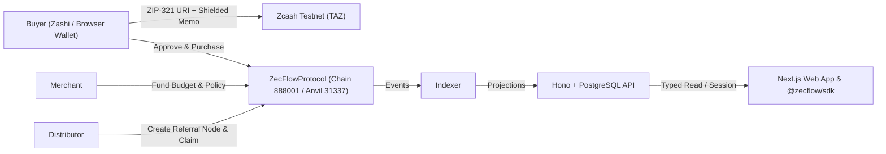

# ZecFlow

**Privacy-preserving open distribution protocol for Zcash.**

[Website](https://usezecflow.xyz) · [Documentation](https://docs.usezecflow.xyz) · [Try the demo](https://usezecflow.xyz/demo) · [Zcash Grant Proposal](docs/ZCASH_GRANT_PROPOSAL.md) · [npm SDK](https://www.npmjs.com/package/@zecflow/sdk)

[](LICENSE)

ZecFlow is an open distribution protocol built for the Zcash ecosystem. Merchants publish products and fund campaign reward budgets. Distributors create referral links that can branch through trusted communities. When a purchase settles, eligible participants on the referral path claim deterministic rewards defined by the merchant's public policy, while buyers and distributors can settle via **Zcash Unified Addresses (`u1` / `utest1`)** and **ZIP-321 shielded payment URIs** with Orchard attribution memos.

**Current deployment:** Programmable escrow & attribution run on **Zcash Testnet Settlement Layer (Chain ID `888001`)** using non-redeemable **ZecFlowToken (`ZFT`)** alongside native **ZIP-321 Zcash Testnet (`TAZ`)** payment URI & QR generation. **Demo mode** is a separate walkthrough with local fixtures.

---

## Why ZecFlow + Zcash?

Traditional referral and affiliate networks leak buyer identities, purchase histories, and social graphs to centralized trackers. ZecFlow combines:

1. **Zcash Shielded Settlement (ZIP-321 & Orchard Memos):**
   - Native validation for **Unified (`u1...` / `utest1...`)**, **Sapling (`zs1...`)**, and **Transparent (`t1...` / `tm...`)** addresses plus **Unified Viewing Keys (`uview1...`)**.
   - **ZIP-321 Payment URI & QR Code Generator** (`zcash:<ua>?amount=...&memo=...`) compatible with Zashi, Ywallet, and Zingo!.
   - Compact **Shielded Attribution Memos** (`zecflow-v1`) encoding campaign, referral node, and order commitments inside encrypted Orchard/Sapling notes.
2. **Verifiable Escrow & Deterministic Splits (`ZecFlowProtocol.sol`):**
   - Pre-funded reward ledgers separate from buyer proceeds ledgers.
   - 1–5 commission levels with nearest-first weighting and remainder-safe rounding.
   - Merchant refund window before finalization, pull-based reward claims, and 24-hour notice for policy updates.
3. **Passkey-First & Encrypted Private Notebooks:**
   - WebAuthn passkeys and PRF-derived AES-256-GCM encrypted campaign notebooks where plaintext never leaves the browser.

---

## Architecture



---

## Monorepo Structure

| Package / App | Description | Path |
| --- | --- | --- |
| **Smart Contracts** | `ZecFlowProtocol`, `ZecFlowToken` (`ZFT`), `PolicyMath`, Foundry tests & invariants | [packages/contracts](packages/contracts/README.md) |
| **Protocol & Zcash Core** | Zod schemas, chain definitions (`888001`, `31337`), ZIP-321 & Zcash address primitives, ABIs | [packages/protocol](packages/protocol) |
| **TypeScript SDK** | Credential-free typed client (`@zecflow/sdk`) for 32 public read methods | [packages/sdk](packages/sdk/README.md) |
| **API Server** | Hono + Drizzle ORM + PostgreSQL + viem canonical chain verification | [apps/api](apps/api/README.md) |
| **Web Application** | Next.js 16 + React 19 + wagmi + AppKit + Zcash Obsidian & Gold UI | [apps/web](apps/web) |
| **Event Indexer** | Canonical event indexing for `ZecFlowProtocol` and `ZecFlowToken` | [indexer](indexer/README.md) |

---

## Quickstart

### Prerequisites
- **Node.js** `>= 24` (`v24.11.1` recommended)
- **pnpm** `10.x`
- **Foundry** (`forge`, `anvil`, `cast`) for Solidity contracts

### Install & Verify

```bash
pnpm install
pnpm contracts:test    # Run all 32 Foundry unit, fuzz, security, and invariant tests
pnpm typecheck         # Typecheck all workspace packages
pnpm vitest run --project protocol --project sdk --project web
pnpm --filter @zecflow/web build
pnpm lint
```

### Local Development

```bash
# Terminal 1: Start local Anvil node
pnpm chain

# Terminal 2: Deploy ZecFlowToken & ZecFlowProtocol locally
pnpm deploy:local

# Terminal 3: Start web & API
pnpm dev
```

---

## Documentation Index

- [Zcash Community Grants (ZCG) Proposal](docs/ZCASH_GRANT_PROPOSAL.md)
- [Verification & Evidence Matrix](docs/evidence.md)
- [Smart Contracts Guide](packages/contracts/README.md)
- [SDK Reference](packages/sdk/README.md)
- [API Server Guide](apps/api/README.md)
- [Indexer Guide](indexer/README.md)
- [Operations & Backup Guide](ops/README.md)

---

## License

MIT — see [LICENSE](LICENSE).
